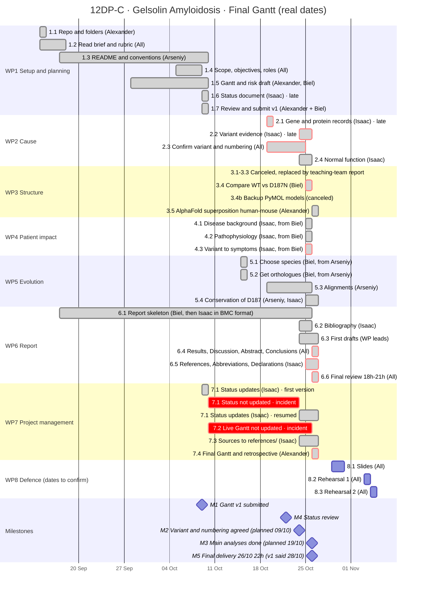

# Gantt (live) with retrospective analysis

Last update: 26/10/2026, 21:00, checked against the commit history of `main`. Bars without colour in WP8 are pending (oral defence, dates to confirm).

Final version of the Gantt chart, reflecting the **real** development of the project up to the delivery on **26/10/2026 at 22:00**. Real dates come from the commit history and from [`status/project_status.md`](../status/project_status.md). The frozen plan submitted on 9 October is in [`gantt_v1.md`](gantt_v1.md).

Weekends are **not** excluded in this version, because a significant part of the work was done on Saturday 24 and Sunday 25 October. Grey bars are completed, red bars mark incidents (periods in which a planned activity did not happen) and bars with a red outline belong to the critical path.

## Retrospective analysis: Gantt v1 vs final

### 1. Main deviations

| Area | Planned (v1) | Real | Cause |
|---|---|---|---|
| Final delivery | 28/10, with buffer day 27/10 | **26/10, 22:00** | v1 used a wrong deadline. Detected on 24/10 (new risk R8): tasks 6.4–7.4 were compressed into 24–26/10 and the buffer day was lost. |
| WP2 Cause (critical path) | 30/09–09/10 | 19/10–26/10 | Gene records (2.1) were done on 19/10 but stayed on a personal branch until 25/10, so the rest of the team did not see them. |
| WP3 Structure | Own PDB selection and comparison, 13/10–19/10 | Structural report provided by the teaching team, interpreted on 25/10; a human–mouse AlphaFold superposition (3.5) was added on 26/10 | Tasks 3.1–3.3 were replaced by the teaching-team report, so the backup task 3.4b was canceled (risk R1 closed without materialising). |
| WP4 Patient impact | Biel, 30/09–21/10 | Isaac, 24/10–26/10 | Reassigned by agreement with Biel. |
| WP5 Evolution | Arseniy, 06/10–16/10 | Species chosen by Biel on 15/10; alignments by Arseniy 19/10–26/10 | Species selection was done by Biel instead of Arseniy. The fly (*Drosophila melanogaster*) was retrieved but officially removed from the aims, the analysis and the structural comparison on 26/10, so the comparison covers horse and mouse only. |
| WP6 Report | Drafts 16/10–20/10, final 22/10–23/10 | Almost all writing on 24/10–26/10, including the weekend | Accumulated delays in WP2–WP5 and the deadline error. |
| WP7 Management | Status twice a week; live Gantt weekly | Status and live Gantt not updated between 09/10 and 24/10 | Recorded as incidents in the status document (7.1, 7.2). |

### 2. What worked

- **Risk analysis.** R2 (187/214 numbering) materialised and was mitigated as planned with a conversion table (`files/data/residue_numbering.md`); R8 (deadline mismatch) was detected and handled by re-planning. R1 (no variant structure) did not materialise, and the backup task 3.4b was canceled.
- **Critical path.** Identifying it helped us prioritise WP2 → WP3 → WP4 → WP6 when the schedule had to be compressed.
- **Version control.** Each member worked on a personal branch and merged through pull requests with merge commits, keeping a traceable history.

### 3. What did not work, and lessons learned

1. **Verify official deadlines against the course documents** before planning. The wrong deadline removed our buffer.
2. **Fix the scientific question early.** Until the mechanism (loss of the Ca²⁺-binding site in G2) was clear, tasks were executed as isolated steps; once it was clear, the analysis and the writing converged quickly.
3. **Merge personal branches frequently.** Work that stays on a branch is invisible to the team and to the contribution graph.
4. **Keep the live Gantt and the status document updated weekly**, so that delays are detected as they happen and not at the end.
5. **Distribute the workload over time.** To reduce the risk of errors and limited the time for review.
