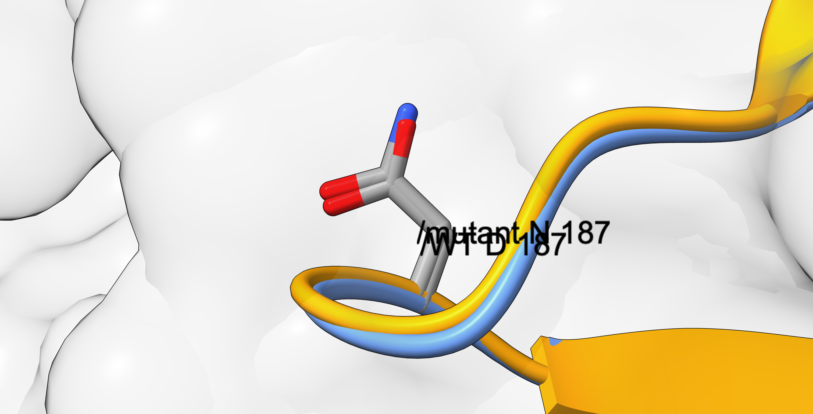
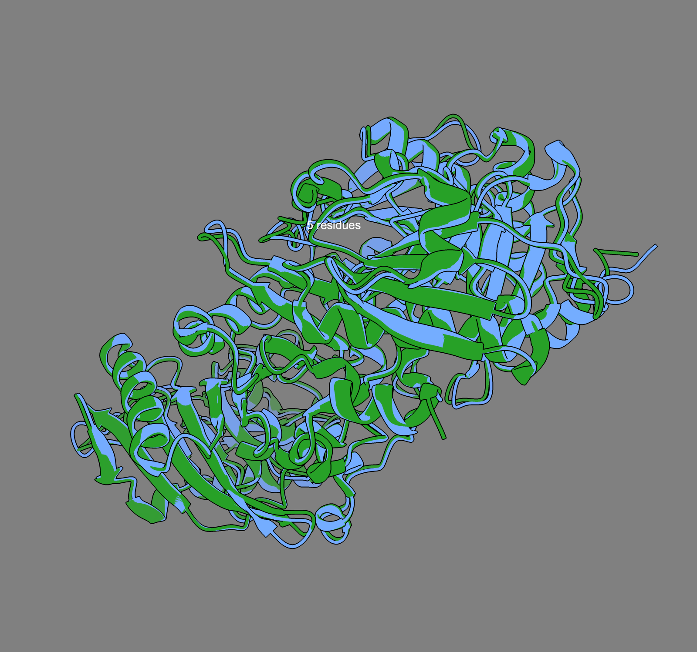

# Molecular basis of Gelsolin Amyloidosis: structural and comparative analysis of the pathogenic *GSN* variant D187N

Alexander, Arseniy, Biel, Isaac

*Introduction to Bioinformatics, Universitat Politècnica de Catalunya (UPC), Barcelona, Spain*

<!--
Format rules (BMC template):
- Max 7 pages or 5000 words (whichever is shorter). References do not count.
- Max 5 figures or tables in total, stored in files/figures/.
- Abstract max 350 words, structured (Background, Results, Conclusions).
- In-text citations: (Author year) / (Author et al. year); list alphabetical, Oxford style.
- UK spelling with -ize; Oxford comma; define abbreviations at first mention.
- Residue numbering: mature numbering (D187N); see files/data/residue_numbering.md.
-->

## Abstract

**Background:** Gelsolin amyloidosis (AGel), also known as familial amyloidosis of Finnish type, is an autosomal dominant systemic amyloidosis characterized by corneal lattice dystrophy, cranial neuropathy, and cutis laxa. It is caused by variants in the *GSN* gene, which encodes gelsolin, a Ca²⁺-regulated actin-binding protein formed by six homologous domains (G1–G6). This study aimed to explain how the variant assigned to our team alters the gelsolin sequence and structure to cause the disease, and to assess the conservation of the affected position in other species.

**Results:** Pairwise alignment of the provided wild-type (WT) and mutant coding DNA sequences (CDS) identified a single missense substitution, c.640G>A, which changes aspartate to asparagine at position 214 of the precursor (p.Asp214Asn), corresponding to D187N in the mature protein. Superposition of WT and mutant structural models showed a global root-mean-square deviation (RMSD) of 0.70 Å and a local backbone displacement of only 0.12 Å at position 187, indicating that the overall fold is preserved. The substitution instead removes the negatively charged carboxylate of a residue that coordinates Ca²⁺ in domain G2. Comparison with horse (*Equus caballus*) and mouse (*Mus musculus*) gelsolin showed high identity at the CDS (92% and 89%) and protein (94.66% and 93.54%) levels, and the residue equivalent to human D187 was conserved in both species. The human and horse structural models superposed with a global RMSD of 1.05 Å.

**Conclusions:** D187N causes gelsolin amyloidosis through a subtle chemical change rather than a large structural rearrangement: the loss of a Ca²⁺-binding ligand destabilizes domain G2, which, according to previous experimental studies, leads to aberrant proteolysis by furin and membrane-type 1 matrix metalloproteinase (MT1-MMP) and to the formation of amyloidogenic fragments. The conservation of this residue in other mammals supports its functional importance and illustrates how sequence and comparative analyses can identify critical positions that are not evident as large structural differences.

## Keywords

Gelsolin, amyloidosis, *GSN*, D187N, calcium binding, protein structure, sequence alignment

## Background

### Gelsolin amyloidosis: clinical picture and epidemiology
Familial amyloidosis of Finnish type (FAF), also known as Meretoja syndrome or gelsolin (AGel) amyloidosis, is a rare hereditary systemic amyloidosis first described in Finnish families in 1969 (Solomon *et al.* 2012). It belongs to the Finnish disease heritage: most patients come from two geographical clusters in south-eastern Finland, where approximately 1000 carriers are estimated, although patients without Finnish ancestry have been reported in many countries, including Spain, Japan, the United States, Denmark, and the Czech Republic, which suggests several independent founders (Solomon *et al.* 2012). The disease is inherited in an autosomal dominant manner, and homozygous patients present an earlier and more severe phenotype, with prominent kidney involvement (Solomon *et al.* 2012, OMIM #105120). As with most rare diseases, it is probably underdiagnosed (Solomon *et al.* 2012).

The first sign, usually appearing between the third and fourth decade of life, is corneal lattice dystrophy caused by amyloid deposition in the cornea (Solomon *et al.* 2012, OMIM #105120). As the disease progresses, amyloid affects cranial and peripheral nerves, producing a slowly progressive polyneuropathy: paresis of the facial nerve, starting in its upper branch, is almost universal, and involvement of other cranial nerves leads to reduced corneal sensitivity, dysarthria, and tongue atrophy, while a mainly sensory peripheral neuropathy and autonomic dysfunction may also develop (Solomon *et al.* 2012). Deposition in the skin causes cutis laxa which, together with facial paresis, gives the face a characteristic drooping, mask-like appearance. In later stages, proteinuria and cardiac conduction abnormalities may appear (Solomon *et al.* 2012). There is currently no treatment targeting the cause of the disease, and management is symptomatic, including eye lubrication, control of secondary glaucoma, and reconstructive facial surgery (Solomon *et al.* 2012).

### The *GSN* gene and the disease-associated variant
Gelsolin is encoded by the *GSN* gene, located on human chromosome 9 (9q33.2; RefSeq NM_000177.5). The gene produces an intracellular (cytoplasmic) and a secreted (plasma) isoform, both composed of six domains (Chen *et al.* 2001). The plasma isoform carries an N-terminal signal peptide of 27 residues that is removed during secretion (UniProt P06396). The sequence analysed in this project corresponds to the plasma gelsolin precursor (NP_000168.1, 782 residues).

The variant assigned to our team is a single nucleotide substitution, c.640G>A, which replaces an aspartate with an asparagine (p.Asp214Asn in precursor numbering). In this report we use the numbering of the mature protein, standard in the gelsolin literature, in which the variant is named **D187N** (mature position = precursor position − 27; see `files/data/residue_numbering.md`). D187N was the first mutation identified as the cause of FAF (Maury *et al.* 1990).

### Normal function of gelsolin
Gelsolin is a calcium-regulated actin-binding protein formed by six homologous domains (G1–G6) (Nag *et al.* 2013). In the absence of Ca²⁺ the protein adopts a compact, inactive conformation; Ca²⁺ binding induces large conformational changes that expose its actin-binding surfaces, allowing gelsolin to sever actin filaments, cap their growing ends and sequester actin monomers (Nag *et al.* 2013). Plasma gelsolin circulates in the blood as part of the actin-scavenging system, which removes actin filaments released from damaged cells (Chen *et al.* 2001, Solomon *et al.* 2012). Ca²⁺ binding does not only activate gelsolin: it also stabilizes the fold of individual domains, which is central to the disease mechanism described below (Kazmirski *et al.* 2002).

### From the D187N variant to amyloid formation
D187 is located in domain G2 (residues 151–266), where its side chain forms part of a metal-binding site that corresponds to one of the two Ca²⁺-binding sites required for the activation of gelsolin and is essential for the stability of G2 (Kazmirski *et al.* 2002). Aspartate carries a negatively charged carboxylate group that coordinates the positive Ca²⁺ ion; asparagine has a side chain of almost identical size but no charge, so the substitution removes this electrostatic interaction without requiring a large change in the protein backbone. As a consequence, D187N disrupts Ca²⁺ binding in G2, and the domain becomes unstable when gelsolin is activated by Ca²⁺ (Kazmirski *et al.* 2002).

This loss of stability triggers an abnormal two-step proteolysis. First, in the trans-Golgi network, the destabilized G2 domain is cleaved between residues 172 and 173 by the protease furin, producing a secreted 68 kDa C-terminal fragment (C68) (Chen *et al.* 2001). Wild-type gelsolin escapes this cleavage because Ca²⁺ binding stabilizes G2 (Chen *et al.* 2001). Second, outside the cell, C68 is cleaved after residue 243 by the membrane metalloprotease MT1-MMP, releasing an 8 kDa fragment (residues 173–243) and a minor 5 kDa fragment (residues 173–225) that aggregate into amyloid fibrils (Chen *et al.* 2001, Page *et al.* 2005).

The resulting amyloidogenic fragments deposit systemically in tissues, which explains the clinical manifestations of the disease described above. Because a single mutant allele is sufficient to cause the disease with apparently complete penetrance, whereas gelsolin knockout mice show only a mild phenotype, gelsolin amyloidosis is considered a gain-of-toxic-function disease rather than the consequence of losing normal gelsolin activity (Solomon *et al.* 2012).

### Aims of this study
The general objective of this study is to characterize how the pathogenic *GSN* variant c.640G>A (D187N) alters the sequence, structure, and function of gelsolin, leading to gelsolin amyloidosis.

The specific objectives are:

1. To identify the human *GSN* gene, the gelsolin protein, and the assigned variant in public databases.
2. To compare the wild-type and D187N gelsolin sequences at the DNA and protein levels.
3. To compare the wild-type and D187N structures and relate the chemical change at position 187 to the Ca²⁺-binding site of domain G2.
4. To assess the conservation of gelsolin, and of position 187 in particular, in *Equus caballus* and *Mus musculus*.
5. To integrate these findings with the clinical picture of the disease.

## Results

### Sequence comparison of wild-type and D187N gelsolin
The alignment of the human wild-type (WT) coding DNA sequence (CDS) with the mutant CDS (see `files/data/Human WT - Human mutant CDS alignment.txt`) showed that the two sequences differ only by a single nucleotide substitution from guanine to adenine (c.640G>A). This missense substitution changes the codon GAC, which encodes aspartate, into AAC, which encodes asparagine, replacing a negatively charged side chain with a neutral one (p.Asp214Asn) (see `files/data/Human WT protein - Human mutant protein alignment.txt`). In the numbering of the mature protein, obtained by subtracting the 27 residues of the signal peptide from the precursor position (214), this variant corresponds to D187N.

### Structural comparison of wild-type and D187N gelsolin

To assess whether the D187N substitution alters the overall fold of gelsolin, the wild-type and mutant structural models were superposed. The global root-mean-square deviation (RMSD) between them was 0.70 Å, a value below 1 Å that indicates that both structures are practically identical at the level of the whole protein.

At the variant position itself, the local backbone displacement between wild-type D187 and mutant N187 was only 0.12 Å, so the substitution does not distort the protein backbone at the variant site (Figure 1). The difference is restricted to the chemistry of the side chain: the carboxylate group of aspartate, which is negatively charged at physiological pH, is replaced by the uncharged amide group of asparagine. Both side chains have a similar size and occupy the same position, but asparagine loses the negative charge and one of the two carboxylate oxygen atoms.

These results indicate that the effect of D187N is chemical rather than structural. In wild-type gelsolin, the side chain of D187 is one of the ligands of a Ca²⁺-binding site in domain G2 (Kazmirski *et al.* 2002, Solomon *et al.* 2012). Removing its negative charge weakens the coordination of the positively charged Ca²⁺ ion, which is required to stabilize G2. This is consistent with the mechanism described in the Background, in which the loss of Ca²⁺ stabilization makes G2 susceptible to aberrant cleavage by furin (Chen *et al.* 2001).

**Figure 1.** Superposition of wild-type (D187) and mutant (N187) gelsolin at position 187 in domain G2. The backbones overlap (local displacement 0.12 Å; global RMSD 0.70 Å), and only the side-chain chemistry changes: the negatively charged carboxylate of aspartate is replaced by the neutral amide of asparagine. Image from the structural conservation report provided by the course instructors.

### Comparison of human gelsolin with other species
To study the disease from an evolutionary perspective, we compared the human WT CDS and protein sequences with those of two homologs: the horse (*Equus caballus*), required by the course instructors, and the mouse (*Mus musculus*), a mammalian model organism with a curated gelsolin precursor equivalent to human plasma gelsolin (see `files/data/homologs_table.md` for the selection criteria). In the alignment between the human WT nucleotide sequence and the horse sequence, the percentage identity is 91.52% (2018/2205) (see `files/data/Human WT - Horse WT CDS alignment.txt`), while for the mouse it is 89% (2069/2327) (see `files/data/Human WT - Mouse WT CDS alignment.txt`). Such high percentage identities over high query coverages suggest a common evolutionary origin and a generally high conservation of function. The human–horse alignment contains no gaps, and the few gaps in the human–mouse alignment are restricted to the region encoding the N-terminal signal peptide; therefore, the reading frame is preserved. At the protein level (see `files/data/homologs_table.md` and the protein alignment files in the same folder), the percentage identities for the horse and the mouse (94.66% and 93.54%, respectively) are higher than at the nucleotide level, most likely because many nucleotide substitutions are synonymous. E-values of 0.0 indicate that these similarities are not due to chance. In both species, the position equivalent to human D187 (D214 in the precursor) is conserved (D163 in horse and D212 in mouse), and domain G2 is largely conserved.
At the structural level, the human and horse gelsolin models superposed with a global RMSD of 1.05 Å (Figure 2). Over the structurally aligned positions, 94.7% of the residues were identical and 96.6% belonged to the same physicochemical class. The horse model lacks the N-terminal region corresponding to the first 53 residues of the human precursor, including the signal peptide, consistent with its shorter curated sequence. At the position equivalent to human D187 the residue is identical, and the local backbone displacement between both species was only 0.30 Å, indicating that the Ca²⁺-binding region of domain G2 adopts the same conformation in human and horse.

**Figure 2.** Superposition of human (blue) and horse (green) gelsolin structural models (global RMSD 1.05 Å). Image from the structural conservation report provided by the course instructors.

## Discussion

Our results show that the molecular basis of gelsolin amyloidosis can be explained by a single chemical change rather than by a large structural rearrangement. At the gene level, the disease is caused by a single nucleotide substitution (c.640G>A) that changes the codon GAC into AAC, and at the protein level it replaces aspartate with asparagine at position 187 of mature plasma gelsolin. The structural comparison showed that this substitution barely affects the protein backbone (global RMSD 0.70 Å; local displacement 0.12 Å), so the overall fold of the mutant protein is preserved. The relevant difference lies in the side chain: aspartate carries a negatively charged carboxylate group that coordinates Ca²⁺ in domain G2, whereas asparagine is neutral.

This interpretation is consistent with previous experimental studies. The crystal structure of domain G2 (PDB 1KCQ) showed that D187 belongs to a metal-binding site corresponding to one of the Ca²⁺-binding sites required for gelsolin activation, and that the D187N substitution disrupts Ca²⁺ binding and destabilizes the domain (Kazmirski *et al.* 2002). This instability exposes G2 to cleavage by furin in the trans-Golgi network (Chen *et al.* 2001) and, after secretion, to a second cleavage by MT1-MMP that releases the amyloidogenic 8 kDa and 5 kDa fragments (Page *et al.* 2005). The fact that a different substitution at the same position, D187Y, also causes the disease supports the idea that the loss of the aspartate side chain, rather than the specific residue introduced, is responsible for the pathology (Solomon *et al.* 2012). Therefore, the low RMSD obtained in our analysis does not contradict the severity of the disease: the variant acts on the stability and dynamics of G2 in the presence of Ca²⁺, which cannot be captured by a static structural model.

The comparison with other species reinforces this conclusion. Gelsolin is highly conserved in horse and mouse at the sequence level, the human and horse structures share the same overall fold, and the position equivalent to human D187 is conserved in both species. The conservation of this residue suggests that it is under strong functional constraint, which agrees with its role in Ca²⁺ binding and domain stability. At the same time, the conservation of the overall fold indicates that the disease does not arise from a general alteration of the protein, but from the loss of one specific, functionally essential interaction.

Finally, these molecular findings connect directly with the clinical picture of the disease. Because a single mutant allele is sufficient to produce the amyloidogenic fragments, the disease behaves as a gain-of-toxic-function disorder with autosomal dominant inheritance (Solomon *et al.* 2012). The systemic deposition of gelsolin amyloid in the cornea, cranial and peripheral nerves, and skin explains the characteristic combination of corneal lattice dystrophy, facial paresis, and cutis laxa observed in patients.

### Limitations

The structural comparison has several limitations. First, the structures analysed appear to be predicted models (they include the signal peptide, which is absent from experimental structures) and contain no Ca²⁺ ions, so the loss of Ca²⁺ binding caused by D187N could not be observed directly and is supported instead by experimental studies (Chen *et al.* 2001, Kazmirski *et al.* 2002). Second, a low RMSD does not imply the absence of a functional effect: a static structure does not capture changes in domain stability or dynamics, which are precisely what D187N alters by allowing G2 to sample partially unfolded conformations (Solomon *et al.* 2012).
Third, conservation was assessed in only two mammalian species that are closely related to humans; the conservation of D187 therefore suggests, but does not prove, a strong functional constraint, and including more distant species would strengthen this conclusion.

## Conclusions

This report shows how a single nucleotide change in the *GSN* gene explains the molecular basis of gelsolin amyloidosis. The c.640G>A substitution replaces aspartate with asparagine at position 187 of plasma gelsolin without altering the overall protein fold, but removes the negative charge of a residue that coordinates Ca²⁺ in domain G2. The resulting loss of Ca²⁺ stabilization makes G2 susceptible to aberrant proteolysis and to the formation of amyloidogenic fragments that deposit systemically. The conservation of this position in horse and mouse, and of the overall gelsolin structure in horse, highlights the functional importance of the Ca²⁺-binding site affected by the variant. Together, these findings illustrate that disease-causing variants can act through subtle chemical changes that are not visible as large structural differences, and that comparative analysis across species helps identify functionally critical residues.

## Methods

### Data sources
The human *GSN* wild-type and D187N coding sequences (CDS, 2349 nt) and protein sequences (782 aa) were provided by the teaching team in FASTA format and identified by BLASTn and BLASTp searches against NCBI databases (100% query cover, 100% identity, E-value 0.0). They were cross-checked against the reference records of the plasma gelsolin precursor in UniProtKB/Swiss-Prot (P06396, reviewed entry), NCBI RefSeq (mRNA NM_000177.5; protein NP_000168.1), NCBI Gene (Gene ID 2934), and Ensembl (ENSG00000148180) (`files/data/gsn_records_summary.md`). The plasma isoform was selected because the disease results from the aberrant processing of secreted gelsolin (Solomon *et al.* 2012).

Orthologous gelsolin sequences of *Equus caballus* (NM_001081953.1 / NP_001075422.1) and *Mus musculus* (NM_146120.4 / NP_666232.2) were retrieved from NCBI RefSeq through BLASTn and BLASTp searches restricted by organism. Curated RefSeq entries were prioritized and, when several isoforms were available, the secreted (plasma-like) isoform was chosen. For the horse, the only curated RefSeq record (NP_001075422.1, 731 aa) lacks the signal peptide and the plasma-specific N-terminal extension and therefore corresponds to the cytoplasmic isoform; because the rest of the sequence, including domain G2 and the position equivalent to D187, is shared by both isoforms, this record was used for the comparison; members of the gelsolin superfamily that are paralogues rather than orthologues (e.g. villin, advillin, and scinderin) were excluded (`files/data/homologs_table.md`). The experimental structure of human gelsolin domain G2 was obtained from the Protein Data Bank (PDB 1KCQ), and clinical and inheritance information from OMIM (#105120). All database records were accessed in October 2026.

### Sequence alignment
The main tool used for sequence matching and sequence alignment is the BLAST (Basic Local Alignment Search Tool) website provided by the National Center for Biotechnology Information (NCBI). BLAST helps analyse and find regions of similarity between different biological sequences. 

Search parameters:

For all the human and homolog nucleotide sequences, the database used was the core nucleotide database (core nt). We specifically optimized for highly similar sequences (megablast).

For all the human and homolog protein sequences, the database used was the reference proteins database (refseq protein). We used the blastp (protein-protein BLAST) algorithm. 

### Structural analysis
*TO DO (Alexander): structures used, superposition, RMSD. (I(Biel) have add a little part, Alexander has to complete)*
Wild-type, D187N mutant and horse (*Equus caballus*) gelsolin structural models, their superposition, global RMSD and per-residue backbone displacement were provided by the course instructors as a structural conservation report. Residue positions are given in mature-protein numbering (D187 = D214 in the precursor).

## Abbreviations

AGel: gelsolin amyloidosis; aa: amino acids; BLAST: Basic Local Alignment Search Tool; CDS: coding DNA sequence; DNA: deoxyribonucleic acid; FAF: familial amyloidosis of Finnish type; MT1-MMP: membrane-type 1 matrix metalloproteinase; NCBI: National Center for Biotechnology Information; nt: nucleotides; OMIM: Online Mendelian Inheritance in Man; PDB: Protein Data Bank; RMSD: root-mean-square deviation; WT: wild type.

## Declarations

**Availability of data and materials:** All data, scripts, figures and sources are available in the project repository: https://github.com/detorotodorov-alexander/12DP-C_GA_IB_2026

**Authors' contributions:** *TO DO (Isaac, at the end).*

## References

Chen CD, Huff ME, Matteson J *et al.* Furin initiates gelsolin familial amyloidosis in the Golgi through a defect in Ca²⁺ stabilization. *EMBO J* 2001;**20**:6277–87.

Kazmirski SL, Isaacson RL, An C *et al.* Loss of a metal-binding site in gelsolin leads to familial amyloidosis–Finnish type. *Nat Struct Biol* 2002;**9**:112–6.

Maury CP, Kere J, Tolvanen R *et al.* Finnish hereditary amyloidosis is caused by a single nucleotide substitution in the gelsolin gene. *FEBS Lett* 1990;**276**:75–7.

Nag S, Larsson M, Robinson RC *et al.* Gelsolin: the tail of a molecular gymnast. *Cytoskeleton* 2013;**70**:360–84.

Online Mendelian Inheritance in Man. #105120 Amyloidosis, Finnish type. https://omim.org/entry/105120 (25 October 2026, date last accessed).

Page LJ, Suk JY, Huff ME *et al.* Metalloendoprotease cleavage triggers gelsolin amyloidogenesis. *EMBO J* 2005;**24**:4124–32.

Solomon JP, Page LJ, Balch WE *et al.* Gelsolin amyloidosis: genetics, biochemistry, pathology and possible strategies for therapeutic intervention. *Crit Rev Biochem Mol Biol* 2012;**47**:282–96.

The UniProt Consortium. Gelsolin (GELS_HUMAN), UniProtKB P06396. https://www.uniprot.org/uniprotkb/P06396 (25 October 2026, date last accessed).
